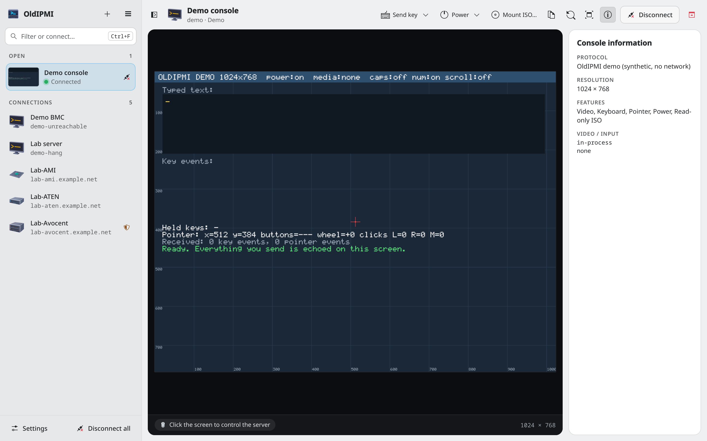

# OldIPMI

**Die Fernkonsole älterer Server, nativ auf dem Linux-Desktop. Ohne Java.**

<picture>
  <source media="(prefers-color-scheme: dark)" srcset="docs/screenshots/console-dark.png">
  
</picture>

Viele Server, die noch gut laufen, haben einen BMC, dessen Konsole ein
Java-Applet oder einen Browser aus einem anderen Jahrzehnt verlangt. OldIPMI
öffnet diese Konsolen direkt: Eine Go-Engine spricht die Protokolle der
Hersteller und dekodiert das Bild in ein Qt-6/Kirigami-Fenster. Java, Browser,
Container oder eine VNC-Brücke braucht es nicht.

[English](README.md) · [Website](https://oldipmi.uggs.io) ·
[Änderungen](CHANGELOG.md) · [Sicherheit](SECURITY.md) · [Mitmachen](CONTRIBUTING.md)

Die Oberfläche von OldIPMI und die ausführliche Dokumentation sind englisch;
diese Seite fasst das Wichtigste auf Deutsch zusammen.

## Funktionen

* **Ein Fenster für alle BMCs:** gespeicherte Verbindungen, beliebig viele
  offene Konsolen mit Live-Vorschau und ein Filter (Strg+F), der aus einer
  eingetippten Adresse eine neue Verbindung macht.
* **Volle Kontrolle:** Tastatur und Maus, Tastenkombinationen wie
  Strg+Alt+Entf, Einschalten, Ausschalten und Reset sowie ein ISO-Abbild als
  virtuelles CD-ROM (nur lesend), wo die Firmware eines anbietet.
* **Von Haus aus sicher:** Passwörter bleiben in KWallet, TLS-Zertifikate
  werden geprüft. HTTP-Login, altes TLS und unverschlüsselte Übertragung sind
  ausdrückliche Ausnahmen, je Verbindung.
* **Klare Fehler:** Jede Verbindung zeigt ihre Stufe, und eine gescheiterte
  sagt, warum und was zu prüfen ist.
* **KI-Agenten:** Über `oldipmi-mcp` kann ein Agent wie Claude Code den
  Bildschirm sehen und tippen, etwa um durch ein BIOS-Setup zu gehen.

## Unterstützte BMCs

| Konsolentyp | Typische Hardware |
|---|---|
| Supermicro (ATEN) | Boards X9 bis X11 und die meisten X8 (Java-iKVM- oder HTML5-Konsole); X12/X13 über Redfish (experimentell) |
| AMI MegaRAC | Ältere AMI-Boards wie das Supermicro X8DTU |
| Dell iDRAC (Avocent) | Dell-PowerEdge-Server der R420-Generation |
| Cisco IMC | Ältere Cisco-UCS-Server der C-Serie |

Welche Wege an echter Hardware geprüft sind und welche nur mit synthetischen
Daten, steht in der englischen README unter
[Compatibility and acceptance](README.md#compatibility-and-acceptance).
Eine eingebaute Demo-Konsole zeigt das Fenster ganz ohne BMC.

## Installation

* **AppImage** für x86_64-Linux: `OldIPMI-<Version>-x86_64.AppImage` und
  `SHA256SUMS` von der
  [neuesten Version](https://github.com/christianreiss/oldipmi/releases/latest)
  in dasselbe Verzeichnis herunterladen und das AppImage mit
  `grep ' OldIPMI-<Version>-x86_64.AppImage$' SHA256SUMS | sha256sum -c`
  prüfen. Nur wenn das `OK` ausgibt, ausführbar machen und starten. Es bringt
  seine Qt- und KDE-Bibliotheken mit und hat seinen Selbsttest auf Fedora 43,
  Ubuntu 22.04 und 24.04 sowie Debian 12 und 13 bestanden. Ohne FUSE startet
  es mit `--appimage-extract-and-run`.
* **Aus dem Quelltext**, auf Fedora oder jeder Distribution mit Qt 6.6 oder
  neuer und KDE Frameworks 6: siehe [Build and run](README.md#build-and-run).
  Ein RPM für Fedora baut `packaging/fedora/build-rpm.sh`.

## Lizenz

OldIPMI steht unter der GNU General Public License, Version 3 oder später
([LICENSE](LICENSE)). Übernommener Code und mitgelieferte Bibliotheken behalten
ihre Lizenzen ([THIRD_PARTY.md](THIRD_PARTY.md)).
