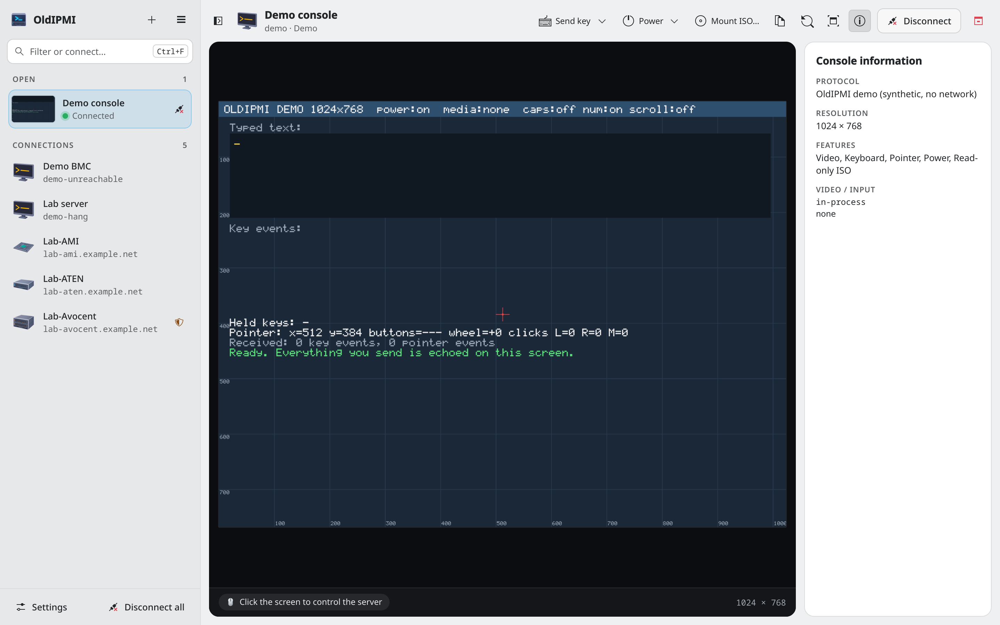
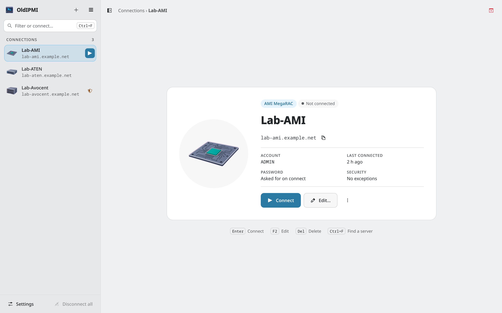
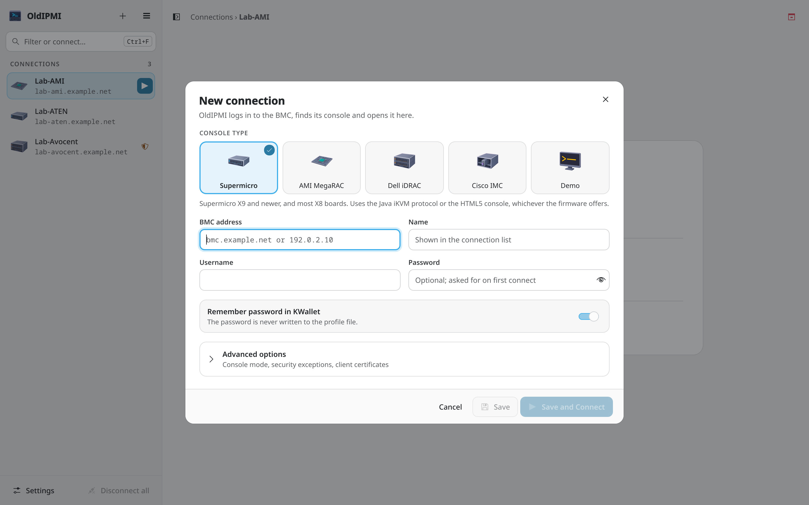
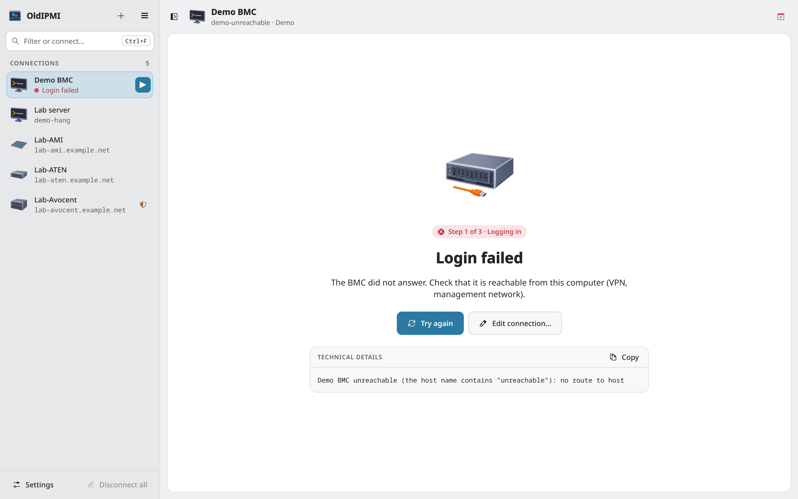
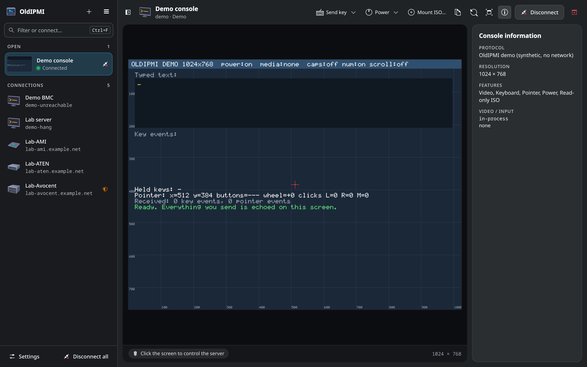

# OldIPMI

**The remote console of older servers, native on the Linux desktop. No Java.**

[](https://github.com/christianreiss/oldipmi/actions/workflows/ci.yml)
[](https://github.com/christianreiss/oldipmi/releases/latest)
[](LICENSE)

<picture>
  <source media="(prefers-color-scheme: dark)" srcset="docs/screenshots/console-dark.png">
  
</picture>

Many servers that still run fine have a BMC whose console wants a Java applet
or a browser from another decade. OldIPMI opens these consoles directly: a Go
engine speaks the vendors' protocols and decodes the video into a Qt 6/Kirigami
window. It needs no Java, browser, container or VNC bridge.

[Deutsch](README.de.md) · [Website](https://oldipmi.uggs.io) ·
[Changelog](CHANGELOG.md) · [Security](SECURITY.md) · [Contributing](CONTRIBUTING.md)

## Features

* **One window for every BMC:** saved connections, any number of open consoles
  with live miniatures, and a filter (Ctrl+F) that turns an address you type
  into a new connection.
* **Full control:** keyboard and mouse, key combinations such as Ctrl+Alt+Del,
  power on, off and reset, and a read-only ISO image as a virtual CD-ROM where
  the firmware offers one.
* **Safe by default:** passwords stay in KWallet and TLS certificates are
  verified. HTTP login, old TLS and unencrypted transport are explicit
  exceptions, per connection.
* **Clear failures:** every connection shows its stage, and a failed one says
  why and what to check.
* **AI agents:** with `oldipmi-mcp`, an agent such as Claude Code can look at
  the screen and type, for example to walk through a BIOS setup.

| | |
|---|---|
|  |  |
|  |  |

## Supported BMCs

| Console type | Typical hardware |
|---|---|
| Supermicro (ATEN) | X9 to X11 boards and most X8 boards (Java iKVM or HTML5 console); X12/X13 through Redfish (experimental) |
| AMI MegaRAC | Older AMI boards such as the Supermicro X8DTU |
| Dell iDRAC (Avocent) | Dell PowerEdge servers of the R420 generation |
| Cisco IMC | Older Cisco UCS C-series servers |

Which paths were verified on real hardware, and which only with synthetic data,
is listed under [Compatibility and acceptance](#compatibility-and-acceptance).
A built-in demo console shows the window without any BMC.

## Install

* **AppImage** for x86_64 Linux: download `OldIPMI-<version>-x86_64.AppImage`
  and `SHA256SUMS` from the
  [latest release](https://github.com/christianreiss/oldipmi/releases/latest)
  into one directory and check the AppImage with
  `grep ' OldIPMI-<version>-x86_64.AppImage$' SHA256SUMS | sha256sum -c`.
  Only if that prints `OK`, make it executable and start it. It brings its own
  Qt and KDE libraries and passed its self-test on Fedora 43, Ubuntu 22.04 and
  24.04 and Debian 12 and 13. Without FUSE, start it with
  `--appimage-extract-and-run`.
* **From source**, on Fedora or any distribution with Qt 6.6 or newer and KDE
  Frameworks 6: see [Build and run](#build-and-run). An RPM for Fedora is built
  with `packaging/fedora/build-rpm.sh` ([Fedora RPM](#fedora-rpm)).

## About

This is a new implementation, not the old launcher repackaged. The previous
container version is recoverable at Git commit `a5b5b9b`.

## Build and run

On Fedora KDE, install Go, CMake, Ninja, a C++20 compiler, `qt6-qtbase-devel`,
`qt6-qtdeclarative-devel`, `kf6-kirigami-devel`, `kf6-kirigami-addons` and
`kf6-kwallet-devel`.

```sh
cmake -S . -B build -G Ninja -DCMAKE_BUILD_TYPE=Release
cmake --build build
./build/oldipmi
```

## Using OldIPMI

The window has two panes (see [DESIGN.md](DESIGN.md)):

* **Connections** (left) lists every saved BMC with its console type, name and
  address. Open consoles are grouped at the top with a live miniature of their
  screen and their state (*Logging in · 0:04*, *Connected*, *Login failed*). Ctrl+F
  focuses the filter; Enter there opens the first match, or **New connection** to the
  address you typed. Double-click, Enter or the play button connects; any number of
  consoles can be open at once, and selecting an open connection shows its console
  while the others keep running. The button of an open row disconnects it; Ctrl+D
  disconnects the shown console, Ctrl+Shift+D (or **Disconnect all** below the list)
  all of them, after naming them when more than one is open. The context menu (right
  click, the menu key or Shift+F10) offers Show/Connect, Disconnect, Edit (F2),
  Duplicate and Delete (Del). **+** (Ctrl+N) opens **New connection**; **Settings**
  sits below the list, **Quit** (Ctrl+Q) at the right end of the header and in the
  main menu ☰. F9 hides or shows the list.
* **New / Edit connection** is a dialog: console type (one tile per family; arrow
  keys move between them; a drop-down in a short window), BMC address (a pasted URL
  is reduced to its host), name, username, password and *Remember password in
  KWallet*. **Advanced options** hold
  the Supermicro console mode, a JNLP endpoint override, the per-host security
  exceptions and client certificates; a profile with exceptions opens them.
  **Save and Connect** (Ctrl+Enter) saves and opens the console in one step.
* The **console pane** (right) shows the selected connection (its account, last
  connection, password and security settings, with **Connect**), then the setup
  progress **Logging in → Discovering console → Connecting** with the elapsed time,
  then the remote screen on a dark stage. Cancel interrupts setup. A failure names
  the step and the cause, suggests the likely fix and shows the technical details
  (Copy puts them on the clipboard), with **Try again** and **Edit connection…**.

Click the remote screen to give it keyboard and mouse; that first click is not sent
to the server. Without a mouse, Tab to *Click the screen to control the server* in
the status strip and press Enter or Space. An accent ring around the picture and
the status strip below it show the capture. While captured, every key goes to the
server, including OldIPMI's own shortcuts. Tap **Right Ctrl** (the tap is still
forwarded; can be switched off in Settings) or click **Release** in the status strip
(in full screen: in the bar at the top edge) to get them back; tap Right Ctrl again
to give them back to the server, also in full screen. Losing focus releases held
keys and buttons. Full screen shows only the remote screen while a console is open;
without one, the header (with Quit) and the connection list stay.

While connected, the toolbar offers **Send key** (Ctrl+Alt+Del, Ctrl+Alt+F1/F2/F7,
Alt+Tab, Alt+F4, Print Screen, Super, Right Ctrl), **Mount ISO… / Eject ISO**
(only when the console reports read-only ISO support), **Power** (chassis
control over IPMI LAN, UDP 623, with the connection's account; every action is
confirmed with its consequence),
**Copy screen image** (Ctrl+Shift+C; puts the remote screen on the clipboard as an
image at its own resolution, without the window around it, e.g. for a ticket),
fit/actual size, full screen (F11, Esc leaves; a bar at the top edge keeps the
console actions and Disconnect at hand, and Quit stays in the top right corner),
**Console information** (protocol,
endpoints, transport, features, resolution; APCP also its protocol version; next to
the console, or over it in a narrow window) and **Disconnect** (Ctrl+D). What does
not fit a narrow window moves to the toolbar's overflow menu ⋮. Mounted ISO files are opened read-only. Media endpoints
are advertised parameters, not proof that an ISO is mounted; firmware/model
information is not guessed.

The first connection asks for a password. *Remember in KWallet* is on by default
(Settings → General changes the default); later connections read the password
from the wallet. If KWallet cannot save it, choose **Connect without saving**.
Passwords are never stored in the profile file. Changing a host or username
requires a fresh credential; editing only the name keeps the saved password.
Duplicating a connection does not copy its password.

**Settings** (main menu ☰ or Ctrl+,) has three pages: *General* (KWallet default,
scaling, Right Ctrl release, shortcut list), *AI agents (MCP)* (agent control on/off,
status, setup, recent agent activity) and *About* (version, file locations).
Preferences are stored in `OldIPMI.conf` in the XDG config directory.

OldIPMI starts with an empty connection list; nothing is built in. Cisco IMC
sends its video as Avocent packet 139, an RLE-compressed bit-slice format (also
byte-plane and raw tiles), which OldIPMI decodes. Its text mode (character cells plus font tables, used by
some BIOS screens) is not drawn yet and fails with an explicit message. The Java iKVM
launch file the BMC hands out only supplies an AMI/ATEN session token and is never
executed or used to fetch code. Every connection logs in and obtains a fresh session.

## Transport compatibility

TLS verification is enabled by default. HTTP login, unverified/legacy TLS and
plain console/media transport are separate per-host exceptions, off by default
for new profiles. The legacy TLS exception also allows obsolete RSA/3DES suites
when required. No BMC TLS configuration, clocks or firmware are changed by OldIPMI.

### Supermicro (ATEN) generations

Choose **Supermicro (ATEN)** for X9 and newer boards and most X8 boards; X8 boards
with AMI MegaRAC firmware (such as the X8DTU) use **AMI MegaRAC**. OldIPMI reads the
BMC's login page first and sends the form that firmware expects (plain `name`/`pwd`
on X9-era firmware, base64 with `check=00` on later X10/X11), so it makes exactly one
login attempt. A rejected password is reported in the Login stage.

*Console mode* (Advanced options, profile key `consoleMode`): **Automatic** tries
the Java iKVM (`ikvm`, then `man_ikvm` JNLP; 8-, 10- and 22-argument layouts) and
falls back to the HTML5 console when the JNLP URL answers 404 *or* a web page
because Java is disabled; **Java iKVM** never falls back; **HTML5** skips the JNLP.
The console info then shows "ATEN HTML5"; virtual media is not available there.
When the HTML5 page is missing, or `login.cgi` is gone (X12/X13, AST2600), OldIPMI
uses a Redfish session and the Supermicro IKVM resource (experimental, see below).
OldIPMI never changes the BMC's Java/HTML5 preference.
Some X10/X11 firmware requires a Supermicro client certificate on the Java iKVM
port (5900; TLS alert "handshake failure"), which OldIPMI does not ship: set such
profiles to **HTML5**.

Older AMI systems may have plain video and an always-TLS HID channel. On the
verified Lab-AMI generation, select AMI and explicitly enable HTTP login,
legacy/unverified TLS and plain console/media. Passwords/tokens never appear in
command-line arguments, profile files or diagnostic output.

For verified Lab-Avocent, select Dell iDRAC (Avocent) and enable legacy/unverified TLS.
Avocent ISO media and packet-134 video are not implemented; the ISO
action is not offered for that family. Cisco uses port 2068, Dell uses port 5900.

ATEN systems requiring mutual TLS need their client certificate/key selected in
the connection's advanced options. The application does not distribute vendor private keys. It also
does not change the BMC's Java/HTML5 console preference automatically.

## Compatibility and acceptance

| Family / target | Implementation | Current evidence |
|---|---|---|
| Legacy AMI / Lab-AMI, Supermicro X8DTU | 7-byte framing, TLS HID, RGB555 VSC raw and LRLE16/32 | Real native 640x480 video decoded and visually inspected; read-only probe re-run 2026-11-06 |
| Newer AMI / ASPEED | 8-byte IVTP, VQ/JPEG decoder, HID, iUSB | Imported regression tests; no hardware acceptance yet |
| ATEN / Supermicro | Token login, Hermon and bit-plane video, HID, power, read-only media (Java iKVM) | Synthetic TCP handshake/video/cancellation tests; no Java-iKVM target supplied |
| ATEN / Supermicro X9–X11 Java iKVM | Plain or base64 (`check=00`) login detected from the login page; 8/10/22-argument JNLP layouts; `ikvm`/`man_ikvm` URLs | Synthetic fixtures only; no Java-iKVM target supplied |
| Supermicro X12/X13 (Redfish iKVM) | Redfish session login, `Oem/Supermicro/IKVM` (X11: `Managers/1/IKVM`) discovery, HTML5 page reuse when it carries the known token | Live 2026-11-06, view only: video on two X12/X13 BMCs (Redfish and cgi discovery; their console needs a client-type byte after the token, detected from the BMC's `rfb.js`); keyboard, pointer and power not run live |
| ATEN HTML5 console (firmware without Java iKVM) | Automatic fallback: WebSocket + ASPEED AST2100 video (shared AMI codec), keyboard, pointer, power; no virtual media | Live: 1600x1200 video, delta updates, keyboard input verified on a LAN ATEN BMC (XCP-ng host); base64 login form and HTML5 fallback re-verified read-only 2026-11-06; pointer and power not run live |
| Avocent / Lab-Avocent, Dell PowerEdge R420 | APCP, TLS companion channel, RGB555 stream, HID | Real native 640x480 video decoded and visually inspected |
| Cisco IMC / Lab-Cisco (bonus target) | APCP 2.34 login, TLS, companion video channel | Live read-only 2026-11-06: login and KVM channel work; video arrives as packet 139 (RLE bit-slice, 1024x768 at 15 bpp, ~100 KB reference frame, 8-byte no-change packets every 1.5 s); decoded, live picture verified 2026-11-06. RLE text mode not drawn yet |

Evidence levels are exactly as stated in the table: "Live" rows were exercised
on real BMCs, everything else is covered by synthetic tests only. Keyboard
input has been verified live on the ATEN HTML5 console only; pointer input,
ISO mounting and power/boot operations have not been run on production
hardware, nor has the Java iKVM path; the Redfish (X12/X13) path is verified for video only. AMI single-port
HTTP CONNECT mode, encrypted HID at the application layer, non-RGB555 legacy
VSC modes, unsupported ATEN encodings, and relative pointer mode are not yet
implemented. Unsupported formats fail explicitly rather than launch Java.

## MCP: let an AI agent drive the console

`oldipmi-mcp` is a stdio [MCP](https://modelcontextprotocol.io) server that
controls the **running OldIPMI window**, so everything the agent does is visible.
**Settings → AI agents (MCP)** shows the register command with the exact path of
`oldipmi-mcp` (Copy button), the full instructions written for the AI (the same text
is sent to MCP clients as the server `instructions`), whether the socket is
listening, which agent is connected (its MCP client name) and its recent actions.
Typed text and key names are never recorded there; keyboard input is only counted.
While an agent is connected, an indicator in the console toolbar names it.

```sh
claude mcp add oldipmi -- /path/to/oldipmi-mcp
```

From the AppImage the bundled path changes on every run: copy `oldipmi-mcp` (a static binary) to a
stable place such as `~/.local/bin`; the settings page then shows that path.

Several consoles can be open at once. Every tool except `list_profiles`, `list_keys`,
`wait` and `connect` takes an optional `profile` (name, id or host); it may be left out
while exactly one console is open, and is required (the error names the open ones) when
several are. `status` lists them under `sessions`; `disconnect` takes `profile` or `all`.

Tools: `list_profiles`, `status`, `connect` (waits up to 60 s for the user to type a
missing password in the window), `disconnect`, `screenshot` (PNG image content; crop,
`scale`, `max_size` default 1568 px, with the exact image-to-framebuffer mapping),
`wait_for_change`, `wait_for_stable`, `wait`, `list_keys`, `type_text` (all printable
US-ASCII), `key` (`ctrl+alt+f1` style, `repeat`), `key_combo`, `key_down`, `key_up`,
`release_input`, `mouse_move`, `mouse_click` (with modifiers), `mouse_double_click`,
`mouse_drag`, `mouse_scroll`, `power`, `mount_iso`, `eject_iso`. Keys: F1–F24, keypad,
SysRq/Break, Caps/Num/Scroll lock, Menu, left/right modifiers, Super. A failing tool
releases only the keys and buttons it holds; when an agent disconnects, everything it
held is released. Passwords stay in KWallet and are never visible to the agent.

Protocol: MCP 2024-11-05 through 2025-11-25 and 2026-07-28; `ping` and
`notifications/cancelled` are handled while a long tool runs; tool calls run one at a
time in arrival order.

The app listens on a Unix socket, `$XDG_RUNTIME_DIR/oldipmi/agent.sock` (owner-only, no
TCP port). **There is no authentication**: any process of your user can control the
console, including `power` (immediate, no confirmation) and ISO mounting. Switch it off
in Settings → AI agents (takes effect immediately, remembered), or start OldIPMI with
`--no-agent-api`; `OLDIPMI_AGENT_SOCKET` overrides the path (Unix socket
paths are limited to about 107 bytes). Only one OldIPMI runs per user session (lock `$XDG_RUNTIME_DIR/oldipmi/instance.lock`): starting it again brings the running window to the front and exits, so two windows can never overwrite each other's profiles.

## Portable bundle

```sh
python3 packaging/bundle.py
./dist/OldIPMI-$(cat VERSION)-x86_64.AppImage
packaging/smoke-test.sh
```

Packaging additionally uses `mksquashfs`, `patchelf`, `qmake6`, `rpm` and
Python 3. It bundles the native executables, the Qt/KDE QML modules, the Qt
plugins OldIPMI uses, a font and the shared libraries they need, including a
private glibc and loader. GPU drivers remain host-provided. The private loader
avoids Fedora Qt libraries requiring a newer host glibc. Outside Plasma, the
AppImage shows the Breeze icons it brings.

Every file the bundle takes from the system must belong to an installed RPM with
a license text: the texts go to `usr/share/licenses`, and
`usr/share/doc/OldIPMI/runtime-packages.txt` names the source RPM of each
package. Without them no AppImage is built; `packaging/licenses` keeps the texts
of the few Fedora packages that install none. Timestamps inside the image are
`SOURCE_DATE_EPOCH`, or the time of the last commit, and the checksum is in
`dist/SHA256SUMS`.

`packaging/smoke-test.sh` runs the AppImage's `--self-test` offscreen on the
build host and in Podman containers with Ubuntu 22.04 and 24.04 and Debian 12
and 13, which have no Qt or KDE of their own. The bundle of 2026-11-21 passed
it; a full desktop session on another distribution has not been tested.

Without FUSE, use `--appimage-extract-and-run`, or `--appimage-extract` and run
`squashfs-root/AppRun`. `dist/OldIPMI.AppDir/AppRun` is the unpacked equivalent.
KWallet requires the host desktop's wallet service; without it use a session-only
password. An inventory of file checksums is included.

## Fedora RPM

```sh
packaging/fedora/build-rpm.sh
sudo dnf install dist/rpm/RPMS/x86_64/oldipmi-[0-9]*.rpm
```

The script packages the committed `HEAD` (it refuses a dirty worktree unless
`--allow-dirty`, and even then packages only `HEAD`), vendors the Go modules
into a second source tarball so the build needs no network, renders
`packaging/fedora/oldipmi.spec.in` with the version from `VERSION`, and
runs `rpmbuild -ba` with `dist/rpm` as its top directory: the SRPM lands in
`dist/rpm/SRPMS/`, the binary RPMs in `dist/rpm/RPMS/x86_64/`. The
`oldipmi-[0-9]*` pattern skips the `-debuginfo`/`-debugsource` packages. Each
run replaces `dist/rpm/`. The spec's `%check` runs `go vet`, `go test -race`,
the CTest suite offscreen and `desktop-file-validate`.

It needs `rpm-build` and the build dependencies of the native build above
(`sudo dnf builddep dist/rpm/SPECS/oldipmi.spec` installs them after a first
run). `--mock` rebuilds the SRPM in a clean mock chroot instead
(`--mock-root fedora-43-x86_64` to choose one; results in `dist/rpm/mock/`),
`--release N` sets the release, and arguments after `--` go to `rpmbuild`.
rpmlint runs when installed. The package's `License` tag is `GPL-3.0-or-later`
for OldIPMI's own code, plus MIT, Apache-2.0 and BSD-3-Clause for the adapted
code and the vendored Go modules.

### Publish to repo.uggs.io

Build separately for each supported Fedora release with an authorized Mock
account. A repeated `--mock-root` builds the same source RPM in each chroot and
writes the results in `dist/rpm/mock/<root>/`.

```sh
packaging/fedora/build-rpm.sh --release 3 \
  --mock-root fedora-43-x86_64 --mock-root fedora-44-x86_64 --mock-root fedora-45-x86_64
```

Copy the main `oldipmi-[0-9]*` binary RPMs to a release directory outside
`dist/rpm/`. Check the accepted publisher fingerprints with
`REPOMAN_URL=https://repo.uggs.io repoman targets` and sign each copy using the key
accepted by its target (`rpmsign --addsign --key-id "$fingerprint" "$rpm"`,
with the corresponding `GNUPGHOME`). Publish with `REPOMAN_TOKEN` or
`REPOMAN_TOKEN_FILE` already supplied by your credential store:

```sh
packaging/fedora/publish-rpm.sh /path/to/signed-release/oldipmi-*.rpm
```

Keep the signed copies for retrying the same release. RepoMan verifies each
signature and publishes the RPM to the target inferred from its Fedora release
and architecture. Increase the RPM release or app version when changing a
published package. The app version lives only in `VERSION`: CMake, both Go
programs (`oldipmi-core --version`) and the RPM read it from there. On a Fedora
machine with the signed `uggs` repo configured, install or update with
`sudo dnf --refresh install oldipmi`, then check its source with
`dnf list --installed oldipmi`.

## Checks

```sh
tools/check.sh
```

runs every check: gofmt, `go vet`, `go mod tidy -diff`, `go test -race`, each fuzz
target for 10 seconds (`FUZZTIME`) with 8 workers (`FUZZPARALLEL`) and a memory limit
of 4 GB for them together (`FUZZMEM`), then
builds `build/` and runs CTest, builds `build-asan/` with AddressSanitizer and
UndefinedBehaviorSanitizer and runs CTest there, and validates the desktop file.
`tools/check.sh --package DIR` runs the part that an offline package build can run
on its finished build directory; the RPM's `%check` uses it.
CTest labels the tests: `ctest --test-dir build -L unit` runs the quick ones,
`-L ui` the three that start the application offscreen. Configuring with
`-DBUILD_TESTING=OFF` builds no tests at all.

The Go tests compare what each console family shows for a run of video packets
with golden pictures in `internal/*/testdata/frames`. After a deliberate change
to a decoder, `UPDATE_GOLDEN=1 go test ./internal/...` rewrites them; look at
the new pictures before committing them.
`GENERATE_STREAMS=1 go test ./internal/video/ast -run TestGenerateGoldenStreams`
writes new AST2100 test streams, after which the pictures need rewriting too.

`testdata/ipc` holds the messages the desktop and its core exchange, as each
side sends them. The Go tests check that the core reads every key the desktop
sends and sends its events in exactly that form; the C++ tests check the desktop
against the same files, with a stand-in core (`desktop/fakecore_test.cpp`) that
plays a script. A change to either side's messages changes these files.
`testdata/ipc/names.json` lists the names (ops, event types, states, power
actions, error codes) and the keys of each message; both sides' tests check their
constants (`internal/backend/ipc.go`, `protocol.Stage*`, `protocol.Power*` and
`protocol.Code*`, and `desktop/ipc.h`) against it in both directions, as does the
`power` tool of `oldipmi-mcp` for its actions. `errors.json` holds errors as the
core words them, with the class it sends as their `code`: the Go tests make the
connection errors for real (`UPDATE_GOLDEN=1` writes them anew) and check each
driver's own word for word, and the `error_hints` test checks that each message
gets the hint of its class. `sequences.json` holds whole
dialogues: the core must send exactly their events, in order, and a Session that
plays them must send exactly their commands.
`testdata/agent` does the same for the agent socket: requests as `oldipmi-mcp`
sends them and the replies the app gave on its demo console. The `agent_api`
test replays them (`UPDATE_GOLDEN=1` records the replies anew), and the MCP
tools are tested on those replies.

CTest runs every test with a fresh, private home and runtime directory
(`tools/isolated.sh`), so it never touches your settings, wallet, `~/.qttest` or
a running OldIPMI. Its `desktop_tour` test walks the screenshot tour below and
leaves the PNGs in `build/tour`.

`oldipmi --self-test` opens a synthetic framebuffer and exits after checking
rendering; it keeps passwords in memory and never opens KWallet. `--preview`
keeps that synthetic preview open. Neither contacts a BMC.
`oldipmi-core --probe` accepts `{ "profile": {...}, "password": "..." }` on
stdin and checks live video without injecting keys or changing power/media.
`oldipmi --probe-ui` accepts the same stdin JSON, resolves a saved profile by
hostname, and tests the complete desktop flow (including KWallet when enabled);
it prints only the connection stages with their texts, allowlisted console
information and the size of the first picture. It ends with 0 once a picture
arrives, 4 when the connection fails or times out, 6 when OldIPMI is already
running (it leaves that window alone) and 7 when the connection needs a password.
`OLDIPMI_TRACE_AVPT=1` makes `oldipmi-core` log Avocent/Cisco AVPT packet types
and 12-byte headers to stderr (for a console opened in the app, the core's stderr
is the app's own: the terminal or the journal); `OLDIPMI_TRACE_AVPT_DUMP=DIR` additionally writes
video payloads (screen content, mode 0600) for codec work. Never commit them.
A connection of type **Demo console (no hardware)** (family `demo`, address `demo`,
`demo-1920x1080` for another size, `demo-fail` / `demo-slow` for failing or slow setup,
`demo-hang` for a login that waits until it is cancelled, `demo-unreachable` for the
error of a BMC that does not answer)
opens a synthetic console that echoes every key, pointer move and click: a BMC-free
end-to-end check of the UI and of all MCP tools.
`oldipmi --self-test --screenshots DIR` walks through every UI state offscreen
(it writes its own test-mode connections first and never touches the network:
the connecting and error states use `demo-hang` and `demo-unreachable`) and saves PNGs
for review; `--size WxH` fixes the window size. Every run saves the same pictures: the
clock stands at a fixed time, each picture waits until dialogs have finished opening
or closing and the window has stopped changing, and lists lay out all their rows. A step
that cannot run or never becomes ready ends the tour with exit code 5. `slop native --config
tools/slop/native.json --root . --out .slop/native` renders the full matrix
(27 states × light/dark × 1200x800/720x480 × scale 1/2 × text 1/1.5) for the
`slop` UI review; build into `build/` first. Each variant runs in a private home with
its own theme settings and animations off; the cache in `.slop/capture-cache` follows
the `oldipmi` and `oldipmi-core` binaries.
`--capture PATH` saves the first frame to a new mode-0600 PNG, only when explicitly
requested. Never commit real console captures or credential-bearing JNLP files.

## Architecture

The GUI owns one backend child per open connection (any number at once, one `Session` each). Two inherited AF_UNIX socketpairs
carry version-1 control messages and RGBA video frames. There are no listening
ports or installed background services. Control records are length-prefixed JSON
(maximum 1 MiB); setup state events include `logging_in`, `discovering`,
`connecting`, and `connected`, plus optional nonsecret `info` metadata; an error
without an id, which ends the setup or the console, names the stage that failed
(`stage`) and, when it is known, the class of the error (`code`); frame records carry width, height and raw RGBA bytes, at most 4096×2160 pixels (`maxFrame` in `testdata/ipc/names.json`).
A one-frame queue drops superseded display frames without delaying input.

Each console family is a Go package under `internal/` whose `driver.go` holds
its `Open`; the core's driver registry (`internal/backend/drivers.go`) maps the
family's id to it, one line per family. `Open` returns a `protocol.Console`
(video, keyboard and pointer); a console with virtual media or chassis power
control also implements `protocol.Media` or `protocol.Power` (IPMI power can be
embedded from `internal/power`, and a virtual CD-ROM builds its answers to the
host's SCSI commands from `internal/scsi`), and the core refuses those commands
for one without. Its console info lists `protocol.FeatureMedia` in `features` when an
ISO can be mounted, which the desktop's ISO action asks for, and an error only
the driver can classify, such as a rejected login, gets its class with
`protocol.Mark` for the error page's hint, with a row in
`testdata/ipc/errors.json` that the driver's tests check (`testkit.ErrorRow`).
`desktop/families.json` describes the
same families for the desktop, which takes their names, hints and connection
options from there (its `about` explains the fields), and
`desktop/images/family-<id>.png` is the family's picture.
`go test ./internal/backend` checks that the table, the registry and the
pictures agree: a new family needs these pieces and its documentation.

Profiles live in `hosts.json` in the application's XDG config directory
(usually `~/.config/OldIPMI/OldIPMI`). The versioned object contains `version`
and `profiles`, plus `defaultsVersion`, which is no longer read but keeps 0.3.0 and
older from adding their former preset connections after a downgrade. It is saved
atomically with owner-only access.
The previous array format is migrated automatically, preserving a
`hosts.json.pre-profiles` backup. To roll back just the profiles feature, use
commit `7cfdb7a` and restore that backup, or export the current object's
`profiles` array to the old `hosts.json` format. KWallet entries use unchanged
profile IDs. Removing a profile also removes its saved wallet entry. Old `.env` files are not
imported or deleted automatically. To roll back, build/run a separate checkout of
`a5b5b9b`; private `.env` configuration remains outside version control.

See [THIRD_PARTY.md](THIRD_PARTY.md) for provenance and licenses.

## License

Copyright © 2026 Christian Reiß.

OldIPMI is free software: you can redistribute it and/or modify it under the
terms of the GNU General Public License as published by the Free Software
Foundation, either version 3 of the License, or (at your option) any later
version. It is distributed in the hope that it will be useful, but WITHOUT ANY
WARRANTY; see [LICENSE](LICENSE) for details.

Code adapted from other projects keeps its MIT license, and the Go modules are
under Apache-2.0 and BSD-3-Clause; [THIRD_PARTY.md](THIRD_PARTY.md) lists every
source with its license text.
